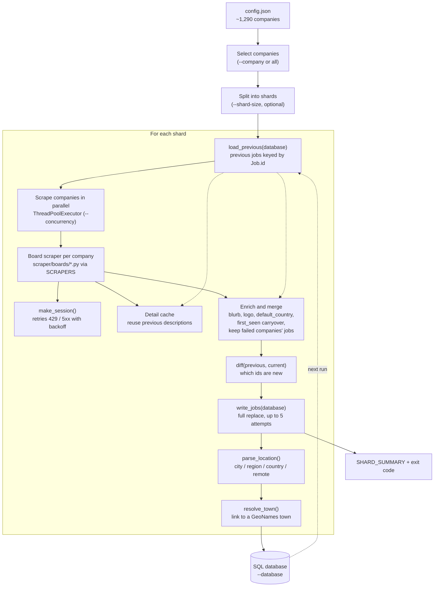

Everything is orchestrated by [`scraper/main.py`](https://github.com/Rain6435/jobby-scraper/blob/main/scraper/main.py). One invocation is one run; there is no long-lived process.

## Stages

### 1. Load configuration

`config.json` is read in full. With `--company`, only that entry is kept. With `--shard-size`, the company list is split into batches by job count (see [Reliability and performance](/jobby-scraper/concepts/reliability-and-performance/#sharding)).

### 2. Load previous state

`load_previous()` in [`scraper/db.py`](https://github.com/Rain6435/jobby-scraper/blob/main/scraper/db.py) rebuilds every stored job as a `Job` object. The previous state drives three things:

- the detail-fetch cache used by boards that make a request per posting;
- carrying `first_seen` (and `role_summary`) forward for jobs already known;
- new-job detection.

There is no other state store. If the database is missing or unreadable, the previous state is empty and every job is treated as new.

### 3. Scrape

Each company is looked up in the `SCRAPERS` registry by its `board` field and its `fetch_jobs()` is called in a thread pool. Any exception is logged and counted as a failure for that company only. Slow companies are re-queued after `--per-company-timeout` seconds.

### 4. Enrich and merge

Fields that live in `config.json` (company blurb, logo, `default_country`) are copied onto each job. Known jobs keep their original `first_seen`; new ones are stamped with the current UTC time.

The snapshot to write is then assembled:

| Situation | Snapshot written |
| --------- | ---------------- |
| Normal full run | Exactly the jobs scraped. |
| `--company X` | Everyone else's previous jobs, plus X's fresh jobs. |
| Some companies failed | Scraped jobs, plus the previous jobs of the failed companies. |
| Interrupted (Ctrl-C) | Scraped jobs, plus the previous jobs of companies that never finished. |

### 5. Diff

`diff()` in [`scraper/storage.py`](https://github.com/Rain6435/jobby-scraper/blob/main/scraper/storage.py) returns jobs whose id was not in the previous state. Those rows get `is_new = true`.

### 6. Write

`write_jobs()` replaces the database contents. Companies, sources and location strings are looked up or inserted once and referenced by id. Each new location string is parsed and linked to a town at insert time. A failed write is retried up to 5 times with backoff; if it still fails, the run exits with code 1. On SQLite, the write-ahead log is checkpointed afterwards so it does not grow unbounded.

## Where the code lives

| Concern | Module |
| ------- | ------ |
| CLI, orchestration, sharding, timeouts | `scraper/main.py` |
| Board registry | `scraper/boards/__init__.py` |
| Base class, retrying session, detail cache | `scraper/boards/base.py` |
| Job model | `scraper/models.py` |
| Config entry types | `scraper/config_types.py` |
| Schema, read and write | `scraper/db.py` |
| New-job diff | `scraper/storage.py` |
| HTML to text | `scraper/text.py` |
| Location parsing | `scraper/location/` |
| GeoNames towns | `scraper/gazetteer.py`, `scraper/town_resolver.py` |
| Single URL parsing | `scraper/link_parser.py` |
| AI helpers | `scraper/summarize.py`, `scraper/ollama_keys.py` |
| Logos | `scraper/logos.py` |

## How it runs in production

This repository has no service of its own. The parent [`job_pipeline`](https://github.com/Rain6435/job_pipeline) project checks it out inside its own tree and runs `python -m scraper.main` as a subprocess on a schedule, then ingests the pool. The [Deploy workflow](https://github.com/Rain6435/jobby-scraper/blob/main/.github/workflows/deploy.yml) pulls each push to `main` onto the production checkout and bumps `job_pipeline`'s pointer to this repo, so the next scheduled run picks up the change.
